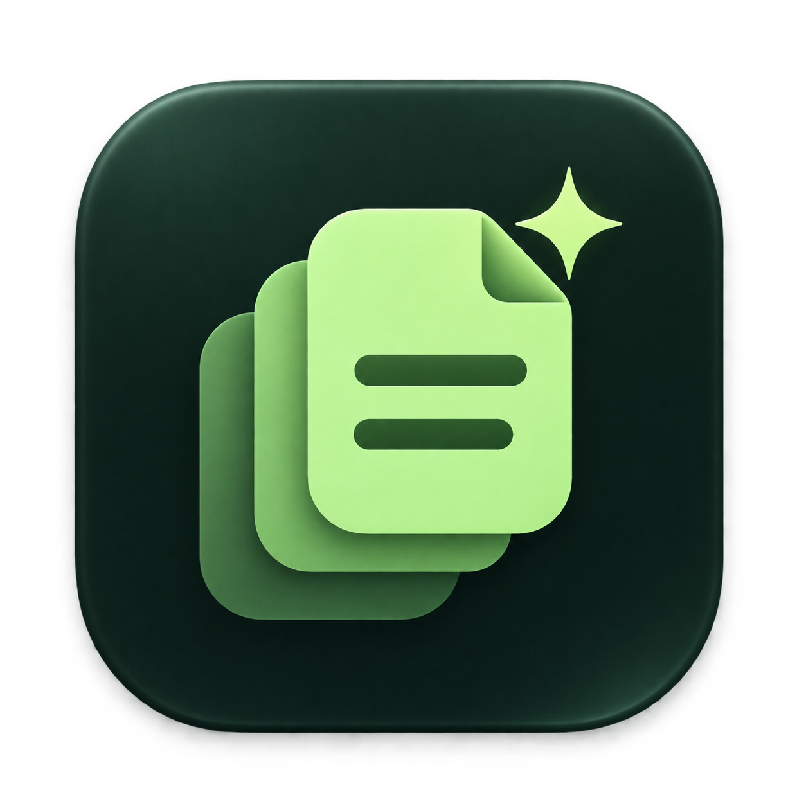
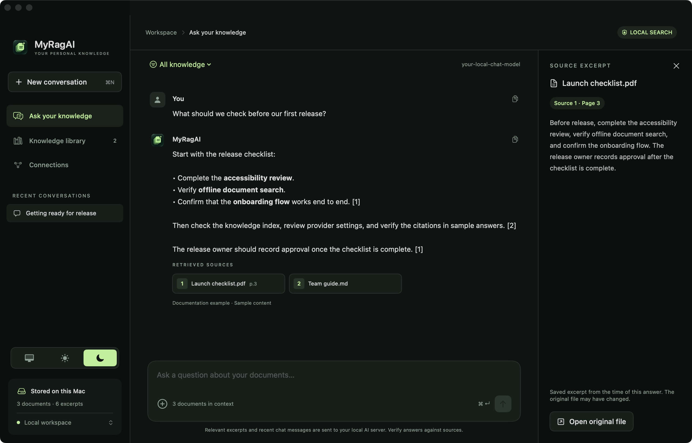
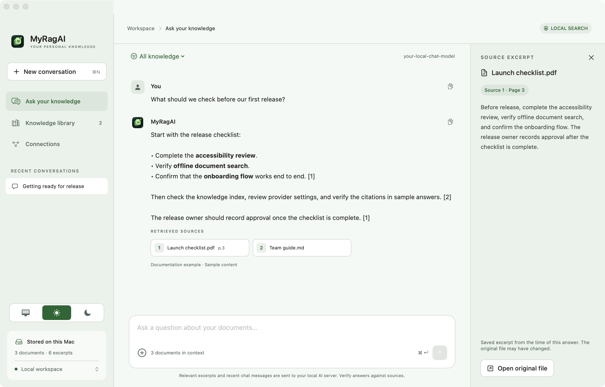
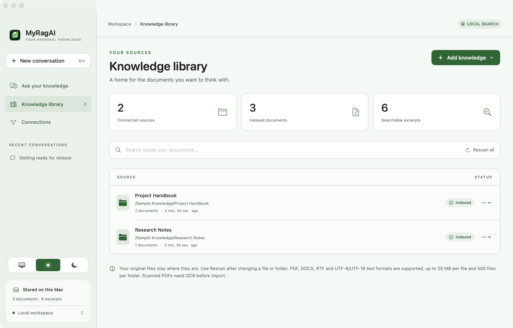
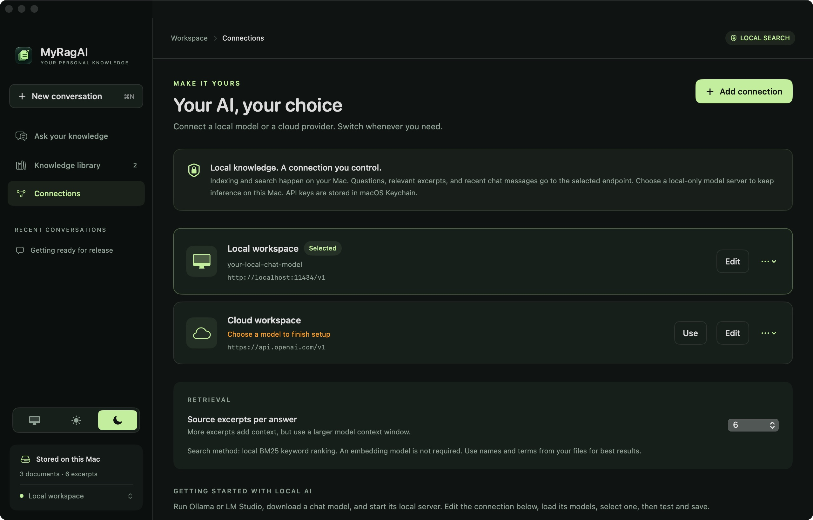

<p align="center">
  
</p>

<h1 align="center">MyRagAI</h1>

<p align="center"><strong>Your documents. Your choice of AI. Answers with sources.</strong></p>

MyRagAI is a native macOS app for asking questions across your PDFs, documents, and folders. It builds a searchable index on your Mac, retrieves relevant passages, and sends those passages to the local or cloud AI connection you choose. Open the source cards beside an answer to check the evidence.

**macOS 14+ · SwiftUI · Local BM25 retrieval · No third-party Swift packages**

> Early development release. Retrieval currently uses keywords, not vector embeddings. Cloud connections send selected excerpts and recent chat text to your chosen provider. Local indexing does not mean every AI connection is offline.

## Download the app

Get the compiled app from [GitHub Releases](https://github.com/alimehdipk/MyRagAI/releases). Under **Assets**, download the **AppleSilicon.zip** build for an M-series Mac or **Intel.zip** for an Intel Mac. Extract it and move **MyRagAI.app** to **Applications**. No Xcode or source code is needed.

Early builds are ad-hoc signed and are not Apple-notarized. If macOS blocks the first launch and you trust the download, open **System Settings → Privacy & Security → Open Anyway**. Requires macOS 14 or newer.

## Publishing a release

The release workflow builds and checks both Mac architectures when a numeric version tag is pushed. Commit the workflow and packaging changes first, then run:

```sh
git tag -a v0.1.4 -m "MyRagAI 0.1.4"
git push origin v0.1.4
```

Watch the **Actions → Release macOS app** run. After both builds succeed, it publishes a release with two app ZIPs and SHA-256 checksums. Use a new tag (for example `v0.1.5`) for each subsequent release; the tag determines the app's version. Release tags must use `vMAJOR.MINOR.PATCH`.

To package only your current Mac's architecture locally:

```sh
bash scripts/package-release.sh 0.1.4
```

Archives appear in `dist/releases/`. Signing with a Developer ID and Apple notarization are not configured in this workflow.

## Screenshots

These are captures of the running macOS app using a separate, in-memory sample workspace. The example answer is prewritten demonstration content; no private documents, API keys, or personal conversations are shown.

| Chat with sources — Dark | Chat with sources — Light |
| --- | --- |
|  |  |

| Knowledge library | AI connections |
| --- | --- |
|  |  |

## Features

- **Import documents or whole folders.** Index supported files recursively and rescan when content changes.
- **Ask across your knowledge.** Search all sources or select specific ones for a question.
- **Inspect the evidence.** Answers include retrieved source cards, saved excerpts, and PDF page references.
- **Choose your AI.** Save multiple connections, discover available models, test a connection, and switch providers.
- **Search without an AI connection.** Browse matching document passages locally, without making a model request.
- **Keep conversations.** Chats and their source excerpts survive restarts.
- **Use Light, Dark, or System appearance.** An icon selector saves your preference.
- **Store provider keys in Keychain.** Credentials are kept separately from the document index and conversations.

## Build and run

### Requirements

- macOS 14 or newer.
- Swift 5.9 or newer, supplied by Xcode or compatible Command Line Tools.
- Python 3 for packaging the app icon; the packaging script uses only the standard library.
- A running local model server or a provider API key for AI answers. Import and search work without either.

```sh
git clone https://github.com/alimehdipk/MyRagAI.git
cd MyRagAI
./scripts/build-app.sh
open dist/MyRagAI.app
```

The script creates an ad-hoc signed app for your Mac's architecture. This is a development build, not a notarized distribution release. You can also open `Package.swift` in Xcode and run the `MyRagAI` target.

After rebuilding, quit and reopen the app to load the new executable and icon. The same artwork is used inside the app and for the Dock icon.

## First conversation

1. Open **Knowledge library → Add knowledge** and choose documents or a folder.
2. Open **Connections** and edit the default Ollama connection or add a provider.
3. Set the base URL, supply an API key if required, and choose a chat model. **Load models** lists models exposed by the server; you can also enter an ID manually.
4. Use **Test connection**, then **Save & use**.
5. Open **Ask your knowledge** and ask a question using names or terms from your documents.
6. Click a source card to inspect the retrieved passage or open its original file.

Use **Rescan** after updating source files. Removing a source removes its index, not your original files. Excerpts already saved in conversations remain until those conversations are deleted.

### Local AI

Run Ollama or LM Studio separately, download a chat model, and start its server before connecting. A model is not bundled with MyRagAI. Whether a localhost server itself routes requests to the cloud depends on that server's configuration.

## Supported providers

| Provider | Default API base URL | Authentication |
| --- | --- | --- |
| Ollama | `http://localhost:11434/v1` | Optional key |
| LM Studio | `http://localhost:1234/v1` | Optional key |
| OpenAI | `https://api.openai.com/v1` | API key |
| OpenRouter | `https://openrouter.ai/api/v1` | API key |
| Anthropic | `https://api.anthropic.com/v1` | API key; native Messages API |
| Custom | Your server's base URL | Optional key; OpenAI-compatible API |

Choose a **text chat model**: provider model lists may also contain embedding or other non-chat models. Model IDs are discovered or entered, not hardcoded. A ChatGPT subscription does not supply an API connection to this app. Tests and conversations may incur provider charges.

## Supported files and limits

| Content | Handling |
| --- | --- |
| PDF | Text extraction with page references; scanned pages need OCR first |
| DOCX, RTF | Text extracted through macOS document readers |
| TXT, Markdown, CSV, TSV, JSON, YAML, XML, HTML, logs | UTF-8 or BOM-marked UTF-16; markup is indexed as text |
| Folders | Recursive import; hidden files, symbolic links, and package descendants are skipped |

Limits: **20 MB per file**, **500 supported files per folder**, **1,000 pages per PDF**, and **2,000 excerpts per document**. Import notes identify skipped or unreadable files. The original files remain in their original locations.

## How retrieval works

1. Extract readable text locally.
2. Split it into overlapping windows of roughly 260 words, with a 45-word overlap. Very long windows are additionally bounded by character count.
3. Rank passages using local **BM25 keyword retrieval** and the selected source scope.
4. Send the top passages, the question, and bounded recent conversation text to the selected AI endpoint.
5. Display the answer with numbered source cards and saved excerpts.

If no passages match, the app normally reports that without calling the model. Short follow-ups can use the previous question for retrieval. Generic overview questions can sample opening passages across documents; these are partial overviews, not exhaustive summaries.

Source cards show retrieved evidence. They do not guarantee that every generated claim is correct; verify answers against the passages.

## Privacy and security

| Data | Storage or transmission |
| --- | --- |
| API keys | macOS Keychain, with a separate entry for each connection; loaded into memory when needed |
| Extracted text, paths, chat history, citations, connection settings | Local `~/Library/Application Support/MyRagAI/workspace.json` |
| AI requests | Question, relevant excerpts, and recent chat text sent to the selected endpoint |

The workspace JSON is **not encrypted by the app**. It is saved atomically with restricted file permissions. Keys are excluded from that JSON.

Remote endpoints require HTTPS; HTTP is allowed only for loopback connections. Credentials are sent in authentication headers, and redirects are refused. Requests use ephemeral URL sessions. There is no included analytics or background cloud synchronization.

Switching providers can send recent conversation text to the newly selected provider. Keychain protection does not make document or chat storage encrypted.

## Current limitations

The following are **not implemented yet**:

- Semantic embeddings, vector search, and reranking.
- OCR for scanned PDFs or images.
- Automatic folder watching and background reindexing.
- Streaming responses.
- Database-backed indexing for large collections.
- App-level encryption for the document index and chat history.

## Development

Run the core checks:

```sh
./scripts/test.sh
```

The dependency-free check runner works with Command Line Tools and does not require XCTest. It covers Unicode chunking, excerpt size bounds, ranking and source filtering, citations, endpoint validation, provider request formats, response decoding, persistence, corrupt-file handling, folder rescanning, and PDF page extraction.

| Path | Responsibility |
| --- | --- |
| `Sources/RagCore/` | Models, text extraction, retrieval, prompts, provider client, persistence, Keychain |
| `Sources/MyRagAI/` | Native UI, application state, appearance, and app resources |
| `Tests/RagCoreChecks/` | Executable core checks |
| `Assets/AppIcon.png` | Source app icon |
| `scripts/build-app.sh` | Release build, icon representations, app bundle, ad-hoc signing |
| `docs/screenshots/` | Screenshots from the sample workspace |

### Reproduce the screenshots

```sh
./scripts/build-preview.sh
open "dist/MyRagAI Preview.app"
```

This builds the same UI with a separate bundle identity and in-memory sample data. It does not load your saved workspace. The sample conversation is a UI demonstration, not a live provider test. Do not enter real credentials into the documentation preview.

## Feedback

Report bugs and suggest improvements through [GitHub Issues](https://github.com/alimehdipk/MyRagAI/issues). Include the macOS version, build steps, and a minimal reproduction. Remove document contents, personal paths, and credentials from logs or screenshots before sharing them.

No open-source license has been selected for this repository yet.
